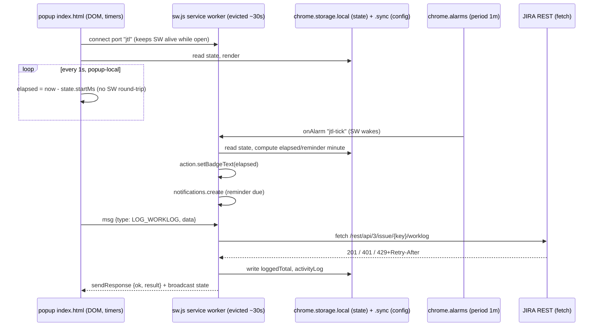

# Migration Plan — Manifest V3 for Chrome + Edge

Target: a single MV3 codebase that loads unpacked in Chrome and Edge, packages for the Chrome Web Store
and Microsoft Edge Add-ons, and runs on current Chromium (Chrome 152 stable, Sept 2026; Edge is the same
Chromium line).

Status of the old path: MV2 is dead. Chrome removed MV2 from the Web Store on 2026-08-31 and stopped
loading MV2 in consumer Chrome from Chrome 139 (June 2025) — "loaded with a warning, fully disabled by
June 2026" (developer.chrome.com/document-lifecycle). Edge shows MV2 install/update warnings from
September 2026, enterprise policy-based deprecation early 2027, MV2 updates blocked at a TBD date
(developer.microsoft.com/microsoft-edge/extensions/whats-new). The committed `.crx`
(`jira-time-logger-chrome.crx`) is also no longer installable in Chrome at all, so the README install
path is broken today.

Deliverable of this plan: the extension works, is published, and the stopwatch/reminder features are
*durable* — they must not depend on a process that Chrome kills after 30s idle.

---

## 1. Root cause of the work

The extension is architected as a **persistent MV2 background page that owns all state**, with the
popup and options page reaching into it through globals.

| Evidence | Why it breaks in MV3 |
|---|---|
| `src/manifest.json:8` `"persistent": true` | MV3 has no persistent background page; the background becomes a service worker (SW) evicted after ~30s idle. |
| `src/js/index.js:14` `var appInstance, configInstance;` + `src/js/Container/ChromeExt.js:80,90` `chrome.extension.getBackgroundPage().appInstance` | `getBackgroundPage` is removed in MV3; the SW has no window object. The popup's entire access to app state is gone. |
| `src/js/Stopwatch.js:175-180` `setInterval(... MILLISEC_IN_MIN)` + `:17` `var start = null` (in-memory) | SW timers do not survive eviction → the running stopwatch silently stops accruing and the start time is lost. Core feature loss. |
| `src/js/App.js:20` `this.loggedTotal = 0`, `:23` `activityLogs = new ActivityLog()`, `:24` `timeManual` (all in-memory) | Day total, recent-activity log and manual-entry state vanish on every SW restart. README features 15-18 are lost. |
| `src/js/Jira.js:447-471` `$.ajax` with `async: false` (`:463`) | Synchronous XHR: absent in SW (`XMLHttpRequest` does not exist there). Every Jira method is synchronous and returns via the `ajaxValues` side-channel (`:45`, getter `:80-83`, setter `:94`) — the whole chain must become promise-based. Deepest change in the codebase. |
| `src/js/require.js:36` `g.exec=function(b){return eval(b)}`, `:33-34` runtime `<script>` injection; `src/js/require-plugin/text.js:252-288` XHR fetch; `json.js:13` `eval('('+val+')')` | MV3 CSP forbids `eval`/`new Function` in extension pages and SW. RequireJS 2.1.15 needs `document` (`:34` `getElementsByTagName`), XHR, and eval → unusable in the SW. `json!/config/config.json` (`src/js/Config.js:17`) throws at boot. |
| `src/js/jquery.min.js:4` `Function("return "+n)()`, `:6` `_evalUrl` (`dataType:"script"`, `async:!1`); `src/js/modernizr.min.js:4` html5shiv `Function(...)` + `yepnope.injectJs`; `src/gumby/js/libs/gumby.min.js:1` `Modernizr.load({...})` injecting `js/libs/jquery.mobile.custom.min.js` (path does not exist) | All are CSP violations (`Function`/remote-code loading). `src/gumby/css/gumby.css:2` `@import url(http://fonts.googleapis.com/...)` is remote + plaintext CSS: blocked by MV3 extension-page CSP and mixed content. |
| `src/js/App.js:305-308` `document.createElement` + `alert()`, `:492` `confirm()`, `src/js/Config.js:145,156` `alert()`, `src/js/index.js:42` `alert()` | `document`, `alert`, `confirm` do not exist in a SW → `TypeError` on the error path. |
| `src/js/Container/Abstract.js:131,144` `document.dispatchEvent` / `addEventListener` | No `document` in a SW; `Event/Dispatcher/Abstract.js` and `Event/Listener/Abstract.js:52-55` inherit this. |
| `src/js/index.js:16-43` + `Container/ChromeExt.js:67` `setupMessageListener()` in the constructor | Listeners register *asynchronously* (after `require([...])` and after `config.init()`'s storage read). MV3 requires listeners registered synchronously at top level, else wake-up events are dropped. |
| `src/js/Container/ChromeExt.js:224-237` `onMessage` listener: `additional.unshift(new Event(name))` (`name` undefined → event type `"undefined"`), never calls `sendResponse`, always `return true` | Every popup `sendMessage` promise rejects with "message port closed before a response was received". Latent MV2 bug, hard failure in MV3. |
| `src/js/Container/ChromeExt.js:119-127` `chrome.extension.getURL` + `tabs.query({url})` | `chrome.extension.getURL` removed (use `chrome.runtime.getURL`); querying tabs by URL needs the `tabs` permission, which is not in the manifest. |
| `src/js/Container/ChromeExt.js:137` `chrome.runtime.reload()` (on config change) | `runtime.reload()` is not available to store-installed extensions (dev-mode only). Self-reload on "Reconfigure" must go. |
| `src/js/Container/ChromeExt.js:204-211` `chrome.management.update({enabled:false})` in `fatal()` | `management` is not in `permissions` → the call throws today. Replace with graceful degradation. |
| `src/js/App.js:658` `container.openURL('mailto:...')` → `Container/ChromeExt.js:147` `chrome.tabs.create` | `mailto:` is not a supported `tabs.create` scheme → "Unsupported URL". |
| `src/manifest.json:26-28` `permissions: [... "https://*.atlassian.net/", "http://fonts.googleapis.com/"]` | Host grants belong in `host_permissions` in MV3; `http://fonts.googleapis.com/` is a non-secure host permission (store-review red flag). A fixed `atlassian.net` grant also **rejects self-hosted JIRA**, which the config UI explicitly supports (`src/config/config.json:2` `urlBase` is user-set, `Jira.js:447` builds every request URL from it). |
| `tests/` Jasmine 2.0.2 + `jasq` 0.4.1 + `mock-ajax.js` (replaces `global.XMLHttpRequest`, `:307-315`) | Browser-only AMD harness; XHR mocking is useless once transport is `fetch`. `tests/main.js:2,19-23` sets `baseUrl: "../src/js"` and requests `"./spec/App.js"` → resolves to `src/js/spec/App.js`, which does not exist: the suite is already broken. |

---

## 2. Decisions taken (and the tradeoffs they buy)

| # | Decision | Rationale / rejected alternative |
|---|---|---|
| 1 | **State moves to `chrome.storage` + `chrome.alarms`.** No in-memory source of truth in the SW. | Alarms are the only MV3 mechanism that fires after SW eviction (min period 30s, Chrome 120+). Rejected: offscreen document as a "keep-alive" — Chrome treats offscreen keep-alive as policy abuse and it is not needed: the stopwatch is a *start timestamp*, so elapsed time is computed, not counted. |
| 2 | **Popup/options talk to the SW by message RPC (`chrome.runtime`), plus a long-lived port while open.** | Chrome 114+ keeps the SW alive while a port is connected (5 min max) → live ticking UI while the popup is open, correct behaviour when it closes. Rejected: `getBackgroundPage` replacement via `chrome.extension.getURL`-style globals — no such API exists. |
| 3 | **JIRA transport lives only in the SW (`fetch`).** Popup never touches the network. | One place for auth, 429 retry, timeouts; keeps the API token out of the UI contexts. Rejected: async `$.ajax` in the popup (XHR is allowed in extension pages) — splits auth/rate-limit logic across two contexts. |
| 4 | **Auth: JIRA Cloud API token (Basic `email:token`), JIRA Data Center/Server via Basic user:pass *and* PAT (`Authorization: Bearer`).** OAuth 3LO is a separate later phase. | Cloud 2FA (mandatory) killed password auth; API tokens are the documented replacement and work with the existing `urlBase`/`urlApi` config shape. OAuth 3LO needs an Atlassian Connect app registration, a redirect URI (`https://<extid>.chromiumapp.org/`) and token refresh — a much larger workstream; ship MV3 first. |
| 5 | **UI stays an action popup.** | Zero UI redesign, smallest diff. `chrome.sidePanel` (Chrome/Edge MV3) is a later phase: a panel that stays open is a genuine UX win for a stopwatch, but it changes layout, persistence and the action-click behaviour. |
| 6 | **Pages keep RequireJS-free ESM + jQuery 4; the SW is plain ESM (no jQuery).** Bundled with esbuild into `dist/`. | jQuery 1.10.1 is EOL with known XSS CVEs (CVE-2019-11358, CVE-2020-11022/11023, CVE-2016-1839) and uses `Function()`/`_evalUrl` (CSP-hostile). jQuery 4.0.0 (2026-01-17) is the current release and CSP-clean for DOM/ajax. Rewriting 5664 lines of prototype/DOM code to vanilla is not required to ship. Full TS rewrite rejected: no build tooling exists today, and the migration risk sits in lifecycle + transport, not types. |
| 7 | **Publish to Chrome Web Store *and* Edge Add-ons.** | MV2 cannot be updated on either. Edge requires its own signed package via Partner Center; `web-ext build -t msedge` produces it. |
| 8 | **`.pem`/`.crx` deleted and purged from history.** | The `.pem` is the extension's private signing key, committed to a public repo (`git ls-files` shows both). It is compromised. It only matters for packed-extension installs, which Chrome no longer supports; the ZIP the store signs is unrelated. Consequence: a new CWS item → new extension ID; existing unpacked installs must be re-added. |
| 9 | **Version 4.0.0.** | `3.0.0` already exists as a tag (`git show-ref --tags`: `3518ff9`), and master contains a `Revert "Version 3.0.0"` commit. |

---

## 3. Target architecture



State schema (`chrome.storage.local`, versioned; config stays in `.sync` so it survives device changes):

```
jtlState  { v:1, startMs, deductedMs, loggedTotalMs, dayKey, lastReminderMinute,
            activityLogs:[{ts, level, msg}] }
jtlConfig { jira:{ urlBase, urlApi, authMode:'cloudToken'|'dcPat'|'dcBasic',
                   email, apiToken, username, password },
            jtl:{ domName, issueKeyPrefix, maxKeyLen, reminderFrequency,
                  maxReminderPerHr, ready } }
jtlRuntime{ configTabId }          // replaces tabs.query({url})
chrome.storage.session (TRUSTED_CONTEXTS): cached token for the current SW lifetime
```

`chrome.storage.local` for state, not `.sync`: state is written every tick (120 writes/min quota on
`.sync`), and `chrome.storage.sync` caps at 100 KB / 8 KB per item.

---

## 4. Manifest, before → after

Current: `src/manifest.json` (30 lines, MV2). Target:

```json
{
  "manifest_version": 3,
  "name": "JIRA Time Logger",
  "description": "Easily keep track of and log time against your JIRA tickets",
  "version": "4.0.0",
  "minimum_chrome_version": "120",
  "icons": { "16": "images/icon16.png", "32": "images/icon32.png",
             "48": "images/icon48.png", "128": "images/icon128.png" },
  "action": {
    "default_title": "JIRA Time Logger",
    "default_icon": { "16": "images/icon16.png", "32": "images/icon32.png",
                      "48": "images/icon48.png", "128": "images/icon128.png" },
    "default_popup": "index.html"
  },
  "background": { "service_worker": "sw.js", "type": "module" },
  "options_ui": { "page": "config.html", "open_in_tab": true },
  "permissions": ["storage", "notifications", "alarms"],
  "host_permissions": ["https://*.atlassian.net/*"],
  "optional_host_permissions": ["https://*/*"]
}
```

Notes:
- `browser_action` → `action`; `options_page` → `options_ui` (the config page needs a real tab).
- No `tabs` permission: `closeConfiguration` (`ChromeExt.js:119-127`) stores the tab id returned by
  `chrome.tabs.create` in `jtlRuntime.configTabId` and closes by id, avoiding the
  "Read your browsing history" warning that `tabs.query({url})` requires.
- No `web_accessible_resources`: there are no content scripts and no resource is referenced by a web
  page. (Local CSS/fonts loaded by extension pages do not need WAR.)
- No `content_security_policy` key: the MV3 default is already the required policy; adding it only
  narrows what is allowed.
- `minimum_chrome_version` buys the 30s alarm minimum and port-based SW keep-alive; Edge honours the
  same key (verify at implementation; drop it if Edge's validator objects).
- Self-hosted JIRA: the options page calls `chrome.permissions.request({origins:["https://jira.corp/"]})`
  from the Save click (user gesture, extension page — not the SW).
- Icons: only `src/images/jira_time_logger_logo.png` (128×128, 14.9 KB) exists; 16px rendering is
  mushy. Generate 16/32/48 with `sharp` in the build script and commit them.

---

## 5. Phases

Each phase is independently loadable (`chrome://extensions` → Load unpacked) and verifiable.

### P0 — Repo hygiene + security (S, no functional risk)
- `git rm jira-time-logger-chrome.crx jira-time-logger-chrome.pem`; purge history with
  `git filter-repo --invert-paths --path jira-time-logger-chrome.pem --path jira-time-logger.crx`
  (force-push; collaborators re-clone). Announce before pushing.
- `.gitignore`: add `dist/`, `node_modules/`, `*.zip`, `*.crx`, `*.pem`, `.web-ext-artifacts/`.
- Delete the vendored demo tree `src/gumby/` (1.1 MB, 73 files) and `src/js/modernizr.min.js`
  (used only by `gumby.min.js`'s yepnope path), `src/js/jquery.base64.min.js` (grep: zero references
  in app code, not in `require-setup.js` paths, not in any `<script src>`),
  `src/js/jquery.color.min.js` (only consumers: the `jqueryColor` dep at `src/js/View/Index.js:11`
  and the `.animate({backgroundColor: 'none'}, 1500)` log-entry highlight at `:154-158`).
- Port the used subset of Gumby into `src/css/app.css`: grid (`row`, `columns one/two/three/four/
  six/medium`, `text-center`, `text-right`), buttons (`btn primary success warning danger rounded
  small medium wide input`), form/`li.field` bits, plus the 7 entypo glyphs in use
  (`icon-cancel`, `icon-cc`, `icon-cc-sa`, `icon-check`, `icon-cog`, `icon-hourglass`, `icon-tools`)
  as an inline SVG sprite — drop the entypo font (`.eot`/`.woff`/`.ttf`) and the Open Sans
  `@import` (system font stack).
- Acceptance: `src/` contains no remote URL, no `@import`, no font files; popup renders identically
  at `min-width: 500px` (`src/css/app.css:4`, inside MV3's 800×600 popup cap).

### P1 — Build + packaging (S/M)
- `package.json` (first build tooling in the repo — `glob` finds no `package.json`, lockfile,
  Makefile, CI config, linter config, or bundler config):
  `esbuild` (bundle `src/js/ui-index.js`, `src/js/ui-config.js`, `sw.js` → `dist/`, ESM, no eval),
  `sharp` (icons), `web-ext` (dev + Edge package), `vitest`, `eslint`, `zip` via `web-ext build`.
  Scripts: `dev` (`web-ext run -t chromium` / `-t firefox-desktop` for Edge), `build`, `test`, `lint`,
  `dist` (produce the store ZIP).
- `.github/workflows/ci.yml`: `npm ci` → `lint` → `test` → `build` → `web-ext lint` → upload ZIP.
- Acceptance: `npm run build` emits a loadable `dist/`; `npm run dist` emits one signed-ready ZIP.

### P2 — MV3 shell + RPC core (M)
- New `src/js/background/sw.js`: **synchronous** top-level registration of
  `runtime.onMessage`, `runtime.onConnect`, `alarms.onAlarm`, `notifications.onClicked`,
  `runtime.onInstalled`, `storage.onChanged`; then async config/state load.
- Replace the DOM-event bus with a typed RPC envelope. `Event/Dispatcher/Abstract.js:47-53` →
  `chrome.runtime.sendMessage({id, source, type, data})` and **always** `sendResponse({ok, result})`;
  `Container/ChromeExt.js:224-237` → dispatch, await handler, respond; delete
  `additional.unshift(new Event(name))` and the unconditional `return true`.
- `Container/ChromeExt.js`: `getBackgroundPage().appInstance`/`configInstance` → RPC calls
  (`getAppState`, `getVersion`, `showConfiguration`, `closeConfiguration` (tab-id), `openURL`,
  `notify`, `clearNotification`, `fatal`); `chrome.extension.getURL` → `chrome.runtime.getURL`;
  drop `chrome.runtime.reload()` (config change re-inits in place: re-read config, re-register alarms,
  broadcast `CONFIG_CHANGED`); `fatal()` → clear alarms + persist an error state the popup renders
  (no `chrome.management`).
- Extension-root-relative URLs must be resolved explicitly: `chrome.tabs.create({url: "config.html"})`
  (`ChromeExt.js:110`) and `notifications.create({iconUrl: 'images/jira_time_logger_logo.png'})`
  (`:174-182`) work from a page, not from a SW → wrap in `chrome.runtime.getURL(...)`.
- `chrome.runtime.sendMessage` (`:199-202`) is called with no callback today. In MV3 it returns a
  promise, and a closed popup means an unhandled rejection that shows up as a SW error. Every send
  site needs a `.catch()` — "popup is closed" is the normal case, not a failure.
- Notification auto-dismiss at `:183-186` is `setTimeout(clear, duration)` with
  `Reminder.js:55` `NOTIFICATION_DURATION_MS = 5000`: the timer is destroyed when the SW is evicted, so
  the notification sticks. Replace with `requireInteraction: false` + an alarm-driven clear (P4).
- `ChromeExt.js:88-91` `getConfigInstance` is declared on the constructor, not the prototype, so it is
  unreachable dead code — delete rather than port.
- The reload path's caller is `Config.js:297` → `configurationChanged()` → `ChromeExt.js:135-137`;
  the in-place re-init replaces that call path, not just the `reload()` line.
- `Container/Abstract.js:120-145`: delete the `document.dispatchEvent`/`addEventListener` path
  (SW); keep DOM events only inside page contexts (`Event/Listener/Abstract.js:52-55`).
- `Container/Factory.js:75` / `Storage/Factory.js:75` string-concatenated `require('Container/'+TYPE)`
  → static imports + a map (unresolvable by a bundler as-is).
- `src/js/require-setup.js`, `require.js`, `require-plugin/text.js`, `require-plugin/json.js`:
  deleted; 23 AMD modules converted to ESM (`define(...)` → `export`/`import`).
  `json!/config/config.json` → `import defaults from '../config/config.json'` (esbuild) in pages;
  the SW imports the same module.
- Acceptance: SW boots with zero console errors; `chrome://extensions` → "service worker (inactive)"
  appears; no CSP/`EvalError` in the SW inspector; popup opens and renders.

### P3 — Transport: sync XHR → promises (L, highest risk)
- `src/js/Jira.js`: `ajax()` (`:445-477`) → `async request(path, opts)` using `fetch` with
  `Authorization`, `Content-Type: application/json`, `AbortSignal.timeout(JiraConstants.AJAX_TIMEOUT_MS)`
  (`JiraConstants.js:55`, 8000ms, used at `Jira.js:471`); every public method (`logWork`,
  `getIssueSummary`, `testConnection`, `testConfig`, `getCurrentUserDisplayName`) returns a promise;
  **delete the `ajaxValues` side-channel** (`Jira.js:45`, `:80-83`, `:94`) — return values directly.
- Delete dead code left from the 2.1.0 subtask removal: `fetchIssueTypes` (`:170-207`),
  `getSubTaskTypes` (`:220-222`), `getIssueTypes`/`setIssueTypes`, `getTransitionID`/`setTransitionID`,
  `getTransition`/`setTransition`, `getTransitionID`, `transitionIssue` (`:235-257`), `createSubTask`
  (`:355`), `getParent`, `getIssueSubTask` (`:328`) — grep confirms these are referenced only from
  each other inside `Jira.js`; no caller exists in `src/js` or `tests`. Remove the matching
  `JiraConstants` entries: `URL_CREATE_ISSUE` (`:40`), `URL_ISSUE_TYPES` (`:43`),
  `URL_TRANSITION` (`:44`), `TYPES_INC_SUBTASKS_NO/ONLY/YES` (`:60-62`).
- Auth header per `authMode`: `Basic btoa(email+':'+apiToken)` (Cloud), `Basic btoa(user+':'+pass)`
  (DC/Server), `Bearer <pat>` (DC/Server 8.14+). `btoa` exists in the SW.
- Endpoints: default `urlApi` → `/rest/api/3/` for Cloud (`src/config/config.json:3` is
  `/rest/api/2/`; v2 remains user-configurable for DC/Server). `testConnection` keeps
  `GET {urlBase}{urlApi}serverInfo` (`JiraConstants.js:39`, `Jira.js:153`).
- Error handling: 401 → "API token invalid / check config" (the historical 401-on-`serverInfo` bug is
  already fixed in `e0d032d`); 403 → permission message; 429 → one retry honouring `Retry-After`
  (Cloud rate limits); non-JSON body → surfaced, not swallowed.
- `App.js:305-308` `alertUser` → strip HTML with a regex (no `document`) + `notifications.create` +
  persist to `activityLogs`; `App.js:492` `confirm()` → popup-side inline confirm (two-step button)
  and a notification with a button; `Config.js:145,156` `alert()` → render in `#configError`
  (`config.html:21`, styled at `src/css/app.css:49-54`); `index.js:42` → persist fatal state.
- Acceptance: `npm run test` covers 200/401/403/429/malformed-JSON; manual log-worklog against a real
  JIRA (Cloud token + a DC/Server PAT) succeeds; popup shows the issue summary.

### P4 — Durable stopwatch + reminders (M)
- `src/js/Stopwatch.js`: keep `startMs` as the single truth; the `setInterval` at `:175-180` plus the
  interval accessors `getInterval`/`setInterval`/`clearInterval` (`:95`, `:106`, `:117`) and
  `start`/`stop` (`:167`, `:191`, which `clearInterval` at `:196`) → `chrome.alarms.create('jtl-tick',
  {periodInMinutes: 1})` + persisted `{startMs, deductedMs}`. `_tick()` (`:318`) becomes a pure
  `computeElapsed(nowMs, state)`; the popup renders from `now - startMs` locally (1s) so the UI ticks
  smoothly with no SW round-trip.
- `src/js/Reminder.js:63-74` `isRequired()` (`elapsedMinutes % frequency === 0`) moves into the alarm
  handler, with `maxReminderPerHr` respected and `lastReminderMinute` persisted so a SW restart cannot
  double-fire. Alarm period 1 min ≥ the 30s MV3 minimum, and it matches today's tick granularity
  (`StopwatchTime.js:34` `MILLISEC_IN_MIN = 6e4`), so cadence is unchanged.
- Badge: `chrome.action.setBadgeText({text: '1h20m'})` (+ `setBadgeBackgroundColor`) from the alarm
  handler — visible stopwatch when the popup is closed (new capability, MV3 `action` API).
- Persist `loggedTotal`/`dayKey`: auto-reset on day rollover (`dayKey !== todayKey`) — replaces the
  `confirm()` prompt in `App.js:492`. Persist `activityLogs` (cap from `config/config.json:9`
  `jtl.maxLogs: 50`, enforced at `App.js:227`; styles at `app.css:101-118`) so "Recent activity"
  survives restarts.
- Notification lifecycle lives in `sw.js`: `notifications.onClicked` → `notifications.clear` + open the
  options page (`chrome.tabs.create({url: chrome.runtime.getURL('config.html')})`); the 5s auto-dismiss
  moves from `setTimeout` (`ChromeExt.js:183-186`) to a one-shot `chrome.alarms` clear so it survives SW
  eviction. Day rollover is handled in the same alarm handler.
- Acceptance (the real test): DevTools → SW → "Stop service worker" while the stopwatch runs → reopen
  popup → accrued time, day total and activity log are all correct and counting continues; alarm fires
  with the popup closed and the browser idle.

### P5 — Config, migration, self-hosted hosts (M)
- `src/config/config.json`: add `authMode`, `apiToken`, `email`; keep `username`/`password` for
  DC/Server; `urlApi` default `/rest/api/3/`.
- `src/js/Config.js`: `ready()` (`:180-183`) validates per `authMode`; `get()`/`set()` (`:147-179`)
  keep the "don't overwrite with empty" rule (`:164`) for `apiToken` too; add a legacy migration on
  `runtime.onInstalled`: read the old `chrome.storage.sync` key `config` (`Storage/ChromeExt.js:42,58`)
  → map `username`/`password` → `email`/`apiToken` **only when they look like a token-shaped value**;
  a Cloud password cannot be converted, so set `jtl.ready = false` and make the popup render a
  "re-authenticate with an API token" call-to-action (README's caveat 47-48 already frames
  reconfiguration as a manual step).
- Options page: auth-mode selector; token field (mirroring the `type=password` field at
  `config.html:35,46`); "Test connection" button (async, uses the existing `#mask`/`#maskText`
  spinner, `app.css:27-47`); `chrome.permissions.request` for non-`atlassian.net` `urlBase` on Save.
- Debounce `getIssueSummary` (`View/Index.js:459` is reached from the `#issue` `keyup`/`paste`
  handlers at `Event/Listener/Index.js:428,444` — a synchronous XHR per keystroke) → 300ms debounce
  + per-key cache.
- Acceptance: existing v2.2.2 install upgrades, shows the re-auth prompt, then logs time; a
  `https://jira.corp/` base works after granting the optional origin.

### P6 — Test suite (M)
- Replace `tests/` (Jasmine 2.0.2, `jasq` 0.4.1, `mock-ajax.js` XHR interception, `SpecRunner.html`
  `data-main` RequireJS bootstrap) with **Vitest**: `jsdom` for popup view specs, node env for
  core specs, `vi.stubGlobal('chrome', ...)` promise-style stubs for
  `storage`/`alarms`/`notifications`/`action`/`runtime.sendMessage`, `vi.stubGlobal('fetch', ...)`
  for JIRA, fake timers for tick/reminder math.
- Port the 5 existing specs (`tests/spec/{App,Config,Jira,Stopwatch,Reminder}.js`) semantics to the
  promise-based APIs; `tests/mock/{Container,Storage}.js` become chrome stubs (they currently stub
  the abstraction layer and contain zero `chrome` references).
- New regression tests must pin the behaviours that broke: elapsed computed from persisted `startMs`
  after a simulated SW restart; reminder fires exactly once per frequency window across restarts;
  RPC handler always resolves (no "port closed"); 401/429 mapping; day-total auto-reset.
- Delete the `tests/main.js` baseUrl/spec path defect rather than repairing the old harness
  (`tests/main.js:2` vs `:19-23`).
- Acceptance: `npm test` green in CI; a deliberately broken `Reminder` window check fails the suite.

### P7 — Publish + docs (S/M)
- Chrome Web Store: new developer item, ZIP from `npm run dist`, privacy declaration (data: JIRA
  credentials, stored locally, not shared), listing screenshots, `minimum_chrome_version` note.
- Edge Add-ons (Partner Center): same ZIP, signed by Microsoft; verify the manifest passes Edge's
  validator (`web-ext lint -t firefox-desktop` as a proxy + manual Edge load).
- `README.md`: replace the `.crx` install sections (lines 21-40) with CWS/Edge Add-ons links +
  "Load unpacked" for Chrome (`chrome://extensions`) and Edge (`edge://extensions`); document the
  API-token setup (Cloud: account → Security → API tokens; DC/Server: PAT), the new caveats
  (token stored in `chrome.storage`, self-hosted host permission prompt) and the badge feature.
- `CHANGELOG.md`: `## 4.0.0` entry (MV3, service worker, durable stopwatch, API-token auth, badge,
  self-hosted support, dropped Google Fonts/Gumby, security: removed committed key material).
- Acceptance: both stores' review packages load unpacked in Chrome 152 and current Edge with zero
  console errors, and a fresh install on each completes first-run config → logged worklog.

### P8 — Optional follow-ups (not required to ship)
- **OAuth 3LO for JIRA Cloud**: `chrome.identity.launchWebAuthFlow` (available in Chrome and Edge
  MV3; `getAuthToken` is not) + `https://<extid>.chromiumapp.org/` redirect + refresh-token handling
  + scoped/unscoped token handling. Needs an Atlassian Connect app registration and PKCE for a public
  client — verify current Atlassian docs before scoping.
- **`chrome.sidePanel`** (Chrome/Edge MV3) as a persistent stopwatch surface, with
  `setPanelBehavior({openPanelOnActionClick: true})`.
- **`web-ext` E2E**: `chrome-launcher` + CDP driving the unpacked extension
  (log a worklog against a local mock JIRA, assert badge + storage state).

---

## 6. Execution order, dependencies, effort

```
P0 (repo/security) ─┐
P1 (build) ─────────┴─→ P2 (MV3 shell + RPC) ─→ P3 (fetch) ─→ P4 (durable state) ─→ P5 (config/migration)
                                                        P6 (tests) tracks P2-P5 spec-by-spec
                                                                                     P7 (publish/docs)
```
- P0 and P1 are parallel and independent; P1 must land before P2 (the SW needs a bundler).
- P3 before P4: reminder/stopwatch logic reads JIRA-derived state (`Reminder.js:75` calls
  `container.getAppInstance().getCurrentUserDisplayName()`), so the transport must be async first.
- P6 is written alongside each phase (a phase is not done until its spec passes), not after.
- Rough size: P0 S, P1 S/M, P2 M, P3 **L**, P4 M, P5 M, P6 M, P7 S/M, P8 L.
- Critical path risk: P3. `Jira.js`'s `ajaxValues` side-channel is internal to that file, but its
  synchronous return style is load-bearing for every caller in `App.js`,
  `Event/Listener/Index.js` and `View/Index.js`: converting it changes the signature of every
  JIRA-facing event handler and the popup's render path. Do it in one cutover, not incrementally —
  a half-async `Jira.js` is unusable.

## 7. Known breakages users will notice (call these out in release notes)

1. Existing installs stop working on upgrade (MV2→MV3 is not an in-place update for unpacked/dev
   installs; the CWS listing is new, so the extension ID changes).
2. Cloud credentials must be re-entered as an API token; a stored Cloud password cannot be migrated.
3. "Reconfigure" no longer reloads the extension (`runtime.reload()` is dev-mode only) — config is
   applied in place; accrued time is no longer lost (improvement over README caveat 48).
4. Self-hosted JIRA now shows a host-permission prompt on Save.
5. Day-total resets automatically at midnight instead of prompting (`confirm()` is unavailable in a SW).
